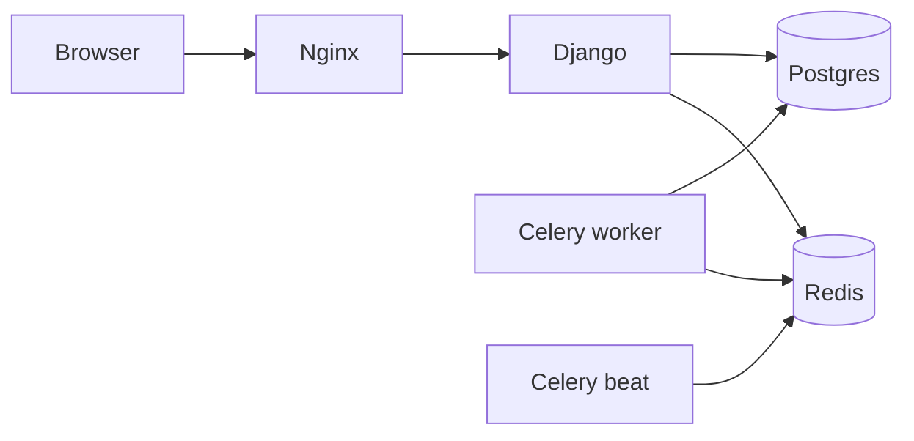

# THRUM

**If it has a pulse, THRUM hears it.**

Open-source, self-hosted tech heartbeat monitoring — web UI, ingest API, and alerts. Run the whole stack with Docker Compose.

> Phase 0 skeleton: Compose stack, Django health API, React shell, Nginx proxy. Product features land in later phases.

## Architecture

```text
[React SPA] → Nginx → Django/DRF API
                         ↓
                    PostgreSQL
                         ↓
             Celery worker + beat ← Redis

Clients (later): POST /api/v1/heartbeat/<monitor_id>/ with API key
```



## Features (v1 roadmap)

- HTTP / TCP / heartbeat monitors
- Status history + retention
- Email + Discord alerts on down/recovery
- Per-monitor API keys (hashed at rest)

### Roadmap (not in v1)

- Telegram / WhatsApp alerts
- Medium / High agent tiers
- Quicktunnel (publish without a public IP)
- Kastora (related future product)

## Quick start

**Preferred:** Docker + Docker Compose on a host (full stack: Nginx, API, worker, beat, Postgres, Redis).

```bash
cp .env.example .env
# set SECRET_KEY in .env

docker compose up --build
```

- UI: http://localhost  
- Health: http://localhost/api/health/  
- Admin: http://localhost/admin/ (create a superuser later)

Low-RAM tip: Celery worker concurrency is `2` in Compose; drop to `1` on tiny hosts.

### Pterodactyl egg (panel) — all-in-one

**No separate database. No separate Redis.** One container runs Postgres + Redis + API + Celery + UI.

1. On the Wings node, build once:  
   `docker build -t thrum-pterodactyl:latest -f pterodactyl/Dockerfile .`  
   (clone this repo first, or see [`pterodactyl/README.md`](./pterodactyl/README.md))
2. Import [`pterodactyl/egg-thrum.json`](./pterodactyl/egg-thrum.json) (Admin → Eggs → Import).
3. Create a **THRUM** server → set **Secret Key** → Install → Start.

The egg clones [MohFarzin/Thrum](https://github.com/MohFarzin/Thrum) and boots the embedded stack. Details: [`pterodactyl/README.md`](./pterodactyl/README.md).

## Creating monitors / Discord / heartbeat curl

Documented after Phases 1–4. See `docs/simple-api.md`.

## Environment

See `.env.example` for `SECRET_KEY`, `DEBUG`, `ALLOWED_HOSTS`, Postgres, Redis, SMTP, `THRUM_PUBLIC_BASE_URL`, and retention defaults.

## Dev setup

Preferred: same Compose stack as production.

Optional local frontend only:

```bash
cd frontend && npm install && npm run dev
```

Backend expects Postgres + Redis (Compose `db` / `redis` services).

## Security notes

- Never commit `.env`
- API keys will be hashed at rest (Phase 3)
- HTTP monitors: http/https only; SSRF mitigations in Phase 5
- See `docs/security.md`

## Updating / backup

Postgres data lives in the `postgres_data` Compose volume. Back that volume up before upgrades.

## Production note

Put a domain + TLS in front (Caddy or external reverse proxy). Later, Quicktunnel can publish this stack without a home public IP.

## License

MIT — see `LICENSE`.
